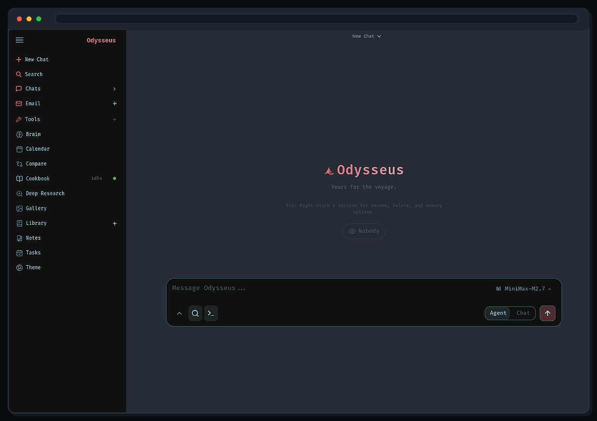

<p align="center">
  
</p>

<p align="center">
  A self-hosted AI workspace for chat, agents, research, documents, email, notes, calendar, and local model workflows.
</p>

<p align="center">
  <a href="#quick-start">Quick Start</a> ·
  <a href="website/setup.md">Setup Guide</a> ·
  <a href="CONTRIBUTING.md">Contributing</a> ·
  <a href="ROADMAP.md">Roadmap</a>
</p>

<p align="center">
  <a href="https://repology.org/project/odysseus-ai/versions"></a>
</p>

<p align="center">
  
</p>

---

## Quick Start

> `dev` is the default branch and gets the newest changes first. Use [`main`](https://github.com/odysseus-dev/odysseus/tree/main) if you want the more curated branch.

```bash
git clone https://github.com/odysseus-dev/odysseus.git
cd odysseus
cp .env.example .env
docker compose up -d --build
```

Open `http://localhost:7011` when the containers are healthy. The first admin password is printed in `docker compose logs odysseus`.

The compose files pull the official multi-arch image `ghcr.io/odysseus-dev/odysseus` (published by CI on every push to `main` and `dev`) and only build locally if the pull fails — so this also works on hosts without a build toolchain, e.g. as a [Portainer](https://www.portainer.io/) stack.

**Production deployments:** pin the immutable tag instead of `:latest`. `:latest` and bare `:X.Y.Z` tags move on every push to `main`, but `:X.Y.Z-<sha>` (e.g. `1.0.2-7c8070f`) always refers to one specific build:

```bash
ODYSSEUS_IMAGE=ghcr.io/odysseus-dev/odysseus:1.0.2-7c8070f docker compose up -d
```

Native installs, GPU notes, Windows/macOS instructions, HTTPS, and configuration live in the [setup guide](website/setup.md).

## Features

- **Chat + Agents** — local/API models, tools, MCP, files, shell, skills, and memory.
- **Cookbook** — hardware-aware model recommendations, downloads, and serving.
- **Deep Research** — multi-step web research with source reading and report generation.
- **Compare** — blind side-by-side model testing and synthesis.
- **Documents** — writing-first editor with AI edits, suggestions, Markdown, HTML, CSV, and syntax highlighting.
- **Email** — IMAP/SMTP inbox with triage, tags, summaries, reminders, and reply drafts.
- **Personal Integrations** — owner-scoped Gmail/Moodle/WhatsApp retrieval, ETH Shibboleth browser access, maps, read-only product discovery, and browser automation. Connector history can be searched with citations through shared RAG; WhatsApp pairing and outbound writes are explicit opt-ins.
- **Notes, Tasks + Calendar** — reminders, todos, scheduled agent tasks, and CalDAV sync.
- **Extras** — gallery/image editor, themes, uploads, web search, presets, sessions, and 2FA.

## Personal Integrations

Open **Integrations** in the sidebar (or **Settings → Integrations**) for guided setup, live connection status, provider instructions, Pull now, automatic pulls and optional semantic indexing. Accounts and encrypted credentials belong to the signed-in owner. Gmail indexing reuses an existing authorized Email account; its Google OAuth/IMAP credentials are not copied into the retrieval index.

**ETH Moodle:** choose the default **Remote window** to see the website and sign in using labeled controls, without tokens or CSS selectors. Check the displayed HTTPS ETH/SSO address and complete MFA yourself. This separate server browser cannot use your local 1Password extension. Password fills pass through Odysseus memory for one requested HTTPS action, are cleared from the UI after success or rejection, and are not saved as connector credentials. **Normal browser** supports your own password manager on ETH: open the generated official Moodle mobile-login link, finish SSO/MFA, cancel any OS Open app prompt, then copy Moodle's **Open app** link address back into the wizard. The random, owner/account-bound handoff expires after 15 minutes and is single-use; Odysseus validates the returned token against the fixed ETH site before encrypting it. It cannot read normal-browser cookies or bypass MFA. If ETH does not offer the link, use Remote window. A manually authorized token remains advanced and optional.

References: [ETH Moodle sign-in guidance](https://ethz.ch/students/en/studies/academic-support/web-based-platforms/moodle-for-students.html), [official Moodle mobile launch protocol](https://github.com/moodle/moodle/blob/MOODLE_500_STABLE/admin/tool/mobile/launch.php), and [Google API eligibility/sunset](https://developers.google.com/custom-search/v1/overview).

**WhatsApp:** choose **WhatsApp** from **Add Integration**, leave **Managed by Odysseus** selected, then **Add and continue**. That explicit action starts preparation automatically and keeps the rotating QR in the same window; **Prepare service and pair** restarts an existing account. The application image includes Node.js 22 and locked bridge dependencies. No environment token, separate Compose launch, root installer, or Docker socket is needed. Scan with WhatsApp → Linked devices. Each account has generated encrypted bridge authentication and private durable storage. Sending is off unless separately authorized and retains agent approval, idempotency and scheduling-confirmation gates. Stop disables restoration, while app shutdown preserves enabled services for restart. Retry after logout resets only managed authentication, not indexed messages. To revoke the device, unlink it on your phone. Provider history is best-effort, not guaranteed complete. Existing external bridges remain administrator-managed; see the [bridge guide](whatsapp-bridge/README.md). Run only one app worker for managed children.

**Search:** administrators can select and test shared search settings in Integrations. Standard Compose provisions SearXNG; DuckDuckGo is an explicit no-key, no-service choice. New settings and wizard selections do not silently fall back to another direct-search provider. Keyed choices include dashboard links and instructions; Google Custom Search JSON API is closed to new customers and sunsets January 1, 2027. Maps needs an owner-scoped OpenRouteService key and a successful Test location; Gmail OAuth requires the administrator's Google project and exact redirect URI. External provider quotas, keys and account authorization cannot be provisioned by Odysseus.

**Agent access:** open **Assistant tools and account access** in Integrations to inherit the owner's accounts, allow selected accounts, or explicitly allow none. Enforcement covers connector reads, retrieval, source indexing/sync and scheduled actions, independently of enabled tool groups. Keyword retrieval needs no vector service; semantic indexing remains opt-in. Browser page/resource/WebSocket egress retains DNS-pinned private-network and checkout/payment guards. Shopping uses public data and never places orders.

For this fork's integrations, build the checked-out source rather than pulling the upstream image:

```bash
ODYSSEUS_IMAGE=odysseus-personal:local docker compose build odysseus
ODYSSEUS_IMAGE=odysseus-personal:local docker compose up -d --no-build
```

Native installs need the complete `requirements.txt` environment and `python -m playwright install chromium` (on supported Linux hosts, `--with-deps` also installs system libraries). Reinstall Chromium after changing the pinned Playwright version. Managed WhatsApp additionally needs Node.js 22.x and `npm ci --omit=dev` in `whatsapp-bridge`; the setup window reports missing runtime prerequisites without running arbitrary installers. The app image bundles both runtimes. Protect Odysseus with HTTPS when entering credentials remotely. Browser field values are cleared from Settings after success or rejection.

Keyword retrieval and citations work without a vector service. Semantic indexing is an explicit per-source option requiring a healthy ChromaDB/embedding setup; deleting a source or replacing its content with empty text removes its previous indexed content. Actual Google OAuth, ETH Shibboleth/MFA and WhatsApp pairing must be completed by the account owner; synthetic protocol/browser checks are not proof of those live account authorizations.
Moodle calendar dates are normalized to UTC for date-filtered retrieval and removal of disappeared events; the next sync also repairs older epoch-string dates. Bounded file/REST fetches request uncompressed responses and reject servers that still return compressed content before decoding it, matching the shared web-fetch safety policy.
Connector tools participate in the request-scoped tool authority and untrusted-content approval gates. Read-only WhatsApp requests do not authorize sends, even before any external content is read; immediate and scheduled sends require affirmative send intent. Scheduled WhatsApp actions validate the same account/confirmation controls from both Settings and agent task creation; their sealed payload cannot be changed after admission. This release freezes the official `dev` update at `c3819e3cbf56c4f899eacc66b21115a77d9c570d`.
Isolated release checks exercise actual managed child processes with synthetic rotating QR data, owner isolation, restart/stop/restore/auth-reset lifecycle, and the real bundled bridge with its WhatsApp provider disabled. Real Chromium checks use intercepted synthetic SSO/MFA pages and official-format mobile callbacks; they verify opaque form controls, HTTPS fills, expiry/binding, encrypted token exchange and secret-free responses. Consumer checks cover assistant grants, scheduled sync, source retrieval, Maps verification, indexing options and explicit search configuration. No live account login, message, purchase or private profile is used. These checks do not prove live provider authorization or semantic-index service health.
The combined Settings UI was also exercised in real Chromium with synthetic owners/providers: Add → automatic preparation → rotating inline QR → connected; ETH labeled SSO/MFA, advanced-token verification without opening a browser, callback expiry/retry, no-key search, account grants and persisted pull/index controls. A complete application image was built and booted on port 7000 with networking disabled: the app and real provider-off bridge ran as UID 1000 with Node 22.22.0 and bundled Chromium, without a Docker socket or creating WhatsApp authentication state.


## Demo

A full hover-to-play tour lives on the [Odysseus landing page](https://odysseus-dev.github.io/odysseus/). Its source lives under [`website/`](website/).

## Contributing

Help is welcome. The best entry points are fresh-install testing, provider setup bugs, mobile/editor polish, docs, and small focused refactors. See [CONTRIBUTING.md](CONTRIBUTING.md) and [ROADMAP.md](ROADMAP.md).

## Security

Odysseus is a self-hosted workspace with powerful local tools. Keep auth enabled, keep private data out of Git, and do not expose raw model/service ports publicly.

- Keep `AUTH_ENABLED=true` for any network-accessible deployment.
- Keep `LOCALHOST_BYPASS=false` outside local development.

Deployment details are in the [setup guide](website/setup.md#security-notes).

## Star History

<a href="https://star-history.dera.page/#odysseus-dev/odysseus&type=date&legend=top-left">
 <picture>
   <source media="(prefers-color-scheme: dark)" srcset="https://star-history.dera.page/svg?repos=odysseus-dev/odysseus&type=date&theme=dark&legend=top-left" />
   <source media="(prefers-color-scheme: light)" srcset="https://star-history.dera.page/svg?repos=odysseus-dev/odysseus&type=date&legend=top-left" />
   
 </picture>
</a>

## License

AGPL-3.0-or-later -- see [LICENSE](LICENSE) and [ACKNOWLEDGMENTS.md](ACKNOWLEDGMENTS.md).
